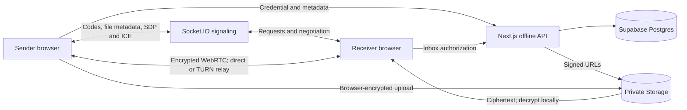

# Swooshit

### Files and text, from one browser to another.

Swooshit moves files, folders, and code snippets between devices without creating an account. Use a six-digit code to request a live transfer, or leave an encrypted item in a temporary inbox for a device that will come online later.

Built for laptop-to-phone sharing and developer workflows, with receiver approval, local folder packaging, and browser-side encryption.

[Get started](#getting-started) ? [Architecture](#architecture) ? [Deployment guide](docs/SWOOSHIT_GUIDE.md)

## Preview

Run the app at `http://localhost:3000` to explore the real interface: **Live transfer**, **Send for later**, an editable code/text panel, and light/dark themes. No verified screenshot or demo video is currently included. Follow the [capture instructions and demo sequence](docs/PREVIEW.md) to add a real product preview. Local browser tests verify file, folder ZIP, and Unicode-text delivery between two isolated Chrome contexts on one Windows host. Cross-device networks, TURN, and hosted offline delivery remain separate deployment checks.

## Features

| Feature | What it does |
| --- | --- |
| Live transfers | Sends file bytes over encrypted WebRTC data channels after receiver approval. Both browsers stay open. |
| Folder sharing | Packages files locally into a ZIP, preserving subfolder paths. Up to 250 MiB and 10,000 files; empty directories are not included. |
| Code and text | Preserves UTF-8 text, indentation, and blank lines in an editable receiver panel with copy support. |
| Send for later | Encrypts items in the browser and uploads ciphertext to private Supabase Storage. Requires optional backend setup. |
| Temporary inboxes | Separate inbox codes, a 25 MiB per-item limit, a 24-hour access window, and server-side quotas. |
| Connection fallback | Uses STUN for direct connections and optional Metered TURN for relayed connections. |
| Transfer feedback | Shows progress and removes outgoing live files after a receiver acknowledgement. This does not prove a file was saved to disk. |

Live signaling validates metadata, limits event rates, reserves codes without overwriting connected devices, and restricts signals to accepted transfer participants. Requests expire after two minutes; negotiation rooms expire after 30 minutes. A live request supports up to 256 files (a folder ZIP counts as one). Read the [operational limits](docs/SWOOSHIT_GUIDE.md#signaling-limits) before deployment.

## Tech stack

| Layer | Technologies |
| --- | --- |
| Interface | Next.js App Router, React 19, TypeScript, Tailwind CSS, Lucide React |
| Browser tools | React Dropzone, JSZip, WebRTC, Web Crypto API |
| Live coordination | Node.js, Express, Socket.IO |
| Optional offline backend | Next.js route handlers, Supabase Postgres and private Storage |
| Deployment configuration | Vercel frontend/API and scheduled cleanup; a separate persistent signaling host such as Render |
| Quality checks | ESLint, TypeScript, Node.js test runner with tsx, GitHub Actions |

Vercel Analytics is integrated in the root layout. Hosting configuration is provided; this repository does not assert a verified public deployment.

## Architecture



Live file contents bypass signaling, although filenames and sizes are included in requests. TURN may relay encrypted traffic. Offline content and filenames use AES-256-GCM encryption; RSA-OAEP wraps the content key for the recipient. The backend sees routing metadata, sizes, item types, and timestamps. Read the [security boundaries](docs/SWOOSHIT_GUIDE.md#security-boundaries).

## Getting started

Use **Node.js 22 or newer**, npm, and a browser with WebRTC and Web Crypto support. Node.js 22 is the CI baseline.

```sh
git clone https://github.com/trushil-patel/droplink.git swooshit
cd swooshit
npm ci
cp .env.example .env.local
```

The clone URL matches the current Git remote; the product and npm package are named Swooshit. Update the URL if the GitHub repository is renamed.

On PowerShell, use `Copy-Item .env.example .env.local`. If PowerShell blocks npm's script shim, use `npm.cmd` in place of `npm`.

The default configuration supports local live transfers. Optional provider settings are commented out in the example; enable them only with your own credentials. Never commit `.env.local`.

Start two terminals:

```sh
# Terminal 1: persistent signaling server, port 3001
npm run signal
```

```sh
# Terminal 2: Next.js frontend and API, port 3000
npm run dev
```

Open `http://localhost:3000` in two separate browser profiles to test distinct device codes. Tabs in the same profile share local storage. If a live code is already in use, the server assigns the new connection a different code; use the code displayed in the receiving tab. For phone testing, use an HTTPS frontend and a signaling URL reachable by both devices; a phone's localhost is the phone itself.

### Environment variables

| Variable | Where | Purpose |
| --- | --- | --- |
| `NEXT_PUBLIC_SIGNALING_URL` | Next.js; included at build time | Reachable signaling URL; defaults to `http://localhost:3001`. |
| `CLIENT_ORIGIN` | Signaling process | Comma-separated frontend origins. Required when NODE_ENV=production; otherwise defaults to localhost:3000 and 127.0.0.1:3000. |
| `PORT` / `SIGNAL_PORT` | Signaling process | Listen port; `PORT` takes precedence, then `SIGNAL_PORT`, then `3001`. |
| `METERED_DOMAIN` | Next.js server only | Optional `your-app.metered.live` host. |
| `METERED_TURN_API_KEY` | Next.js server only | Optional credential API key for TURN fallback. |
| `SUPABASE_URL` | Next.js server only | Optional Supabase project URL. |
| `SUPABASE_SERVICE_ROLE_KEY` | Next.js server only | Privileged offline backend credential; never expose in client code. |
| `CRON_SECRET` | Next.js server only | At least 32 random characters; authorizes scheduled cleanup. |

Next.js loads `.env.local`; the standalone signaling script does not. Configure its variables in your shell or hosting environment. Optional offline delivery requires separately supplied Supabase schema and setup instructions, server-side credentials, and verified scheduled cleanup. The deployment assets are maintained privately and are not included in this repository.

## Usage

1. Open Swooshit on the receiver and share its **Live transfer** code.
2. On the sender, choose files, select a folder, or switch to **CODE / TEXT** and paste a snippet.
3. Enter the receiver's code and request the transfer.
4. Review and accept on the receiver. Keep both browsers open until completion.

For **Send for later**, the receiver must first open that mode to create an inbox. Share its separate code, queue an item on the sender, and wait for **Queued** before closing the page. The receiver returns in the same browser/profile to accept within 24 hours. Clearing site data loses private keys and inbox access.

## Project structure

```text
app/                  Pages, layout, styles, and Next.js API routes
components/           Transfer interface, editor, and theme controls
lib/                  Folder ZIPs, WebRTC config, encryption, and API helpers
server/               Signaling entry point, validation, authorization, and limits
tests/                Unit tests and opt-in Supabase integration test
docs/                 Architecture, deployment, and preview guidance
.github/              CI and dependency update configuration
```

## Development and testing

```sh
npm run lint
npm run typecheck
npm test
npm run build
npm start
```

`npm start` serves the production frontend after a build. Live transfers still require signaling. CI installs the lockfile and runs lint, type checking, tests, and a production build without provider secrets.

Tests cover real local Socket.IO request/accept exchanges, signaling authorization and validation, code collisions, rate/capacity limits, expiry, folder paths, encrypted folder/text workflows, tampering, offline authorization, TURN response handling, receipts, and themes. The Supabase integration test is skipped by default and requires private deployment setup and a dedicated test project. The browser suite below covers same-host WebRTC delivery; it does not replace cross-device or real-network TURN testing.

### Browser regression tests

The Playwright suite builds the real production app, starts dedicated frontend/signaling servers on ports 3100/3101, and uses isolated browser contexts. It verifies binary and empty-file bytes, folder ZIP paths/contents, Unicode text, offline-recipient feedback, and rejection behavior. Provider credentials are disabled for this local suite.

```sh
npx playwright install chromium
npm run test:e2e
```

To use an installed Chrome on PowerShell: `$env:PLAYWRIGHT_CHANNEL = "chrome"; npm.cmd run test:e2e`. Leave ports 3100 and 3101 free. Do not run another Next.js build concurrently with this command. The test build embeds the local signaling URL; rebuild with your real deployment variables before deploying. Test output is ignored under `test-results/`.

Live rejection currently closes the receiver dialog without notifying the sender; the sender remains waiting until they retry/refresh. The test records this limitation, not complete rejection feedback.

## Future improvements

These review opportunities are not implemented features:

- Add deployment-level abuse controls and monitoring for signaling and public TURN credentials.
- Add real-browser transfer regression tests across direct and TURN connections.
- Explore recipient key verification and recoverable inbox identities.

## Author

Built by **[Trushil Patel](https://github.com/trushil-patel)**.

## License

No license has been selected. The author must choose a license before presenting this as a licensed open-source project. See the cleanup report for options.
